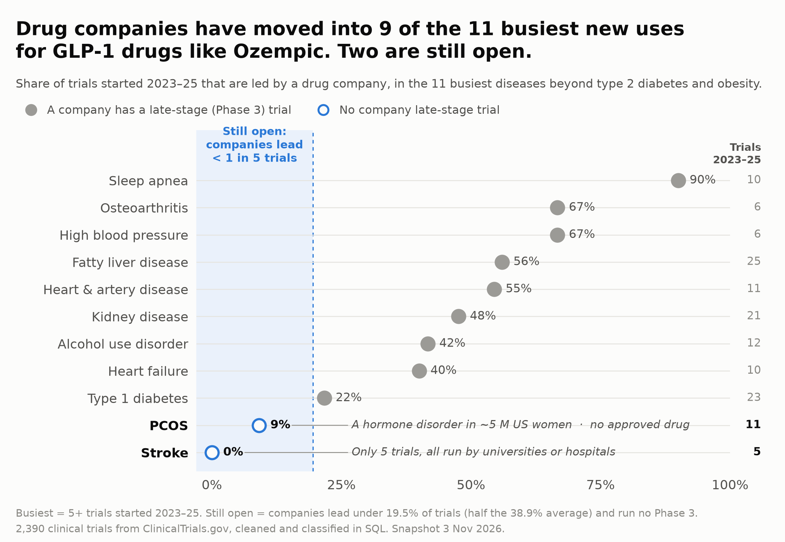
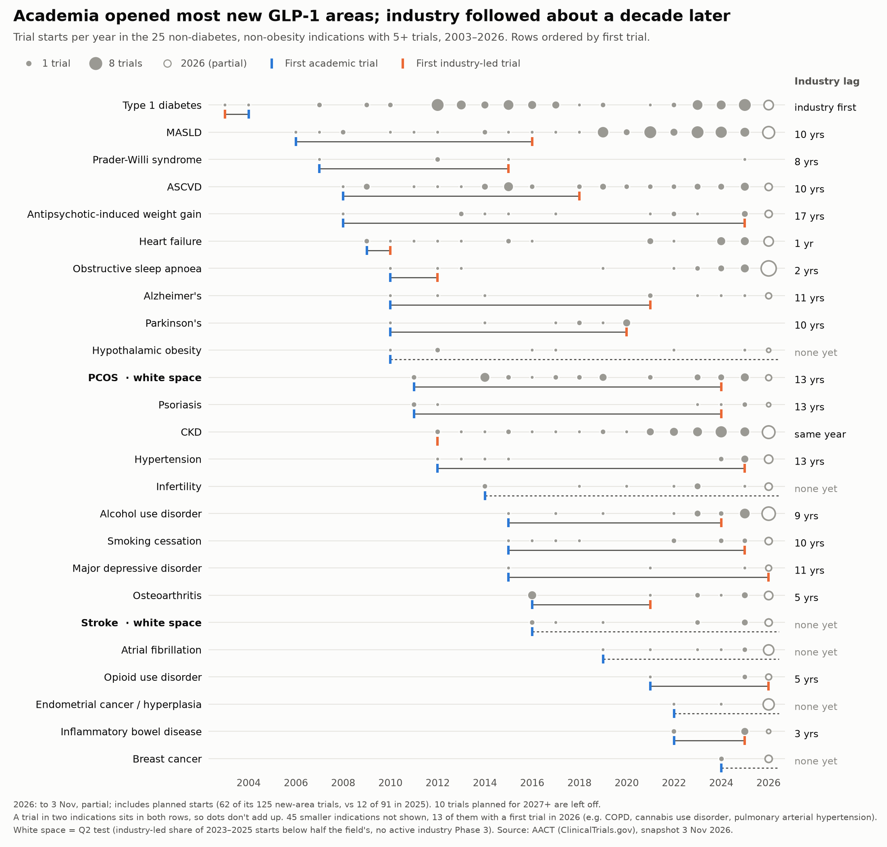

# Where are GLP-1 drugs like Ozempic going next, and have drug companies already got there?

**Drug companies have moved into 9 of the 11 busiest new uses for GLP-1 drugs, each with a
late-stage (Phase 3) trial. Two are still open: PCOS, the stronger lead, and stroke, a thinner one.**

2,390 clinical trials from ClinicalTrials.gov (AACT snapshot, 3 Nov 2026), cleaned and classified in SQL.

<!-- TODO: recheck every number in this file against data/results/ before publishing (5–9 Dec) -->

*Each dot is one disease. Dots left of the dashed line are still open: companies lead under 1 in 5
recent trials and have no Phase 3.*

## Why it matters

I've been a clinical research nurse in urology at National Taiwan University Hospital (NTUH) since 2023,
and the clinical research coordinator on several studies, including a multi-site investigator-initiated
trial with Yale University. From the inside, a new use for a drug usually starts with a doctor's idea,
but it only becomes a trial once someone pays for it, often a drug company. That makes doctor-led trials
an early signal of where a drug is heading, and whether a company has joined them shows how far along it
is. I'm interested in metabolic health, and GLP-1s are now tested in everything from PCOS to alcohol
addiction, so I asked where they're going and where companies haven't followed yet. Answering it took
clinical judgement as much as SQL: deciding which conditions count as one disease, and checking whether
a "completed" trial actually worked.

## What "white space" means

In this project, a trial is **company-led** when a drug company is its lead sponsor, and
**doctor-led** when a university or hospital is. A disease is **white space** (still open)
when companies lead under half their usual share of its 2023–2025 trial starts (under 19.5%,
against a 38.9% average) and no company has a Phase 3 there, active or completed. A disease
needs at least 5 trial starts to be judged; below that it's *too early to call*.

## Findings

### Researchers go first; companies often follow years later

In 6 of the 10 busy diseases companies have entered, doctor-led trials came first by 5 to 13 years
(median 7 years across all 10). PCOS waited longest: doctor-led trials from 2011, the first company-led
one only in 2024. Stroke has had doctor-led trials since 2016 and still no company.

### PCOS is the stronger lead

PCOS (polycystic ovary syndrome) is a hormone disorder that affects about 5 million women in the US and
6 million in the EU (GBD 2023). Of its 11 trials started in 2023–2025, 10 had different lead sponsors and
only 1 was company-led (9%, under the 19.5% bar): a Phase 2 by Hengrui's subsidiary, started in 2024. No
company has a PCOS Phase 3, and no drug is approved to treat PCOS itself. Two doctor-led Phase 3s were
positive, though both were small and came from one research group. The result holds when I tighten or
loosen the bar, and when I drop the 4 trials with unknown status.

### Stroke is the thinner lead

All 5 stroke trials started in 2023–2025 are doctor-led, by 5 different sponsors, and no company has led
a GLP-1 stroke trial in any year (12 trials since 2016). The trials give a GLP-1 in the first days after
a stroke, mostly to protect the brain after clot removal, and no drug is approved in the US or EU to do
that. But the case is thinner than PCOS: the two finished Phase 2s both missed their main goal, the two
Phase 3s (both in China) chase a subgroup signal, and if I count only trials where the GLP-1 sits in an
arm labelled experimental, it drops to 3 trials, *too early to call*.

### Brenipatide and the watchlist

<!-- DRAFT (23 Nov, not yet approved) -->

The next openings are early, and one company is already moving into them. Since October 2025, Lilly has
started 12 trials of brenipatide, its new GIP/GLP-1 drug, in 9 diseases outside diabetes and obesity:
addiction (alcohol, opioids, smoking), mental health (depression, bipolar disorder, weight gain from
antipsychotics), asthma, COPD and IBS. Four are already Phase 3: two in alcohol use disorder and two in
depression. Brenipatide is registered mostly under its code (LY3537031), so my first trial list missed
it; finding it closed three of the ten early signals below.

The watchlist holds diseases too small for the white-space test (under 5 trial starts in 2023–2025) but
with at least 3 trial starts in 2023–2026, 3 or more different lead sponsors, and no company-led trial.
These are early signals, not recommendations: there is no growth test, and some rest on trials that are
planned but not yet started.

| Disease | Trials 2023–26 | Lead sponsors | Of which planned |
|---|---:|---:|---:|
| Atrial fibrillation | 10 | 9 | 6 |
| Endometrial cancer and atypical hyperplasia | 8 | 8 | 4 |
| Infertility | 7 | 7 | 3 |
| Breast cancer | 5 | 5 | 2 |
| Methamphetamine use disorder | 4 | 3 | 1 |
| Cancer therapy-induced metabolic toxicity | 3 | 3 | 0 |
| Cannabis use disorder | 3 | 3 | 2 |

Three of the seven have no approved drug in the US or EU (methamphetamine use disorder, cannabis use
disorder, cancer therapy-induced metabolic toxicity). Endometrial cancer has none for the
fertility-sparing treatment its trials test.

### Q3: how fast each area reaches Phase 3

<!-- DRAFT (23 Nov, not yet approved). Chart 3 is deferred; this table stands in for it. -->

Reaching Phase 3 shows how far a disease has come, but not that the drug works there: Alzheimer's and
Parkinson's both reached Phase 3 and failed. So the table also shows where each Phase 3 stands.

| Disease | First phased trial | First Phase 3 | Years to Phase 3 | Phase 3s: active / completed / unknown |
|---|---:|---|---:|---|
| **PCOS** | 2014 | 2016, doctor-led | 2 | 5: 1 / 3 / 1 |
| **Stroke** | 2016 | 2025, doctor-led | 9 | 2: 2 / 0 / 0 |
| Atrial fibrillation | 2025 | 2025, doctor-led | 0 | 1: 1 / 0 / 0 |
| Infertility | 2020 | 2020, doctor-led | 0 | 3: 1 / 1 / 1 |
| Cannabis use disorder | 2026 | 2026, doctor-led | 0 | 1: 1 / 0 / 0 |
| Endometrial cancer and atypical hyperplasia | 2022 | none yet | – | – |
| Breast cancer | 2024 | none yet | – | – |
| Methamphetamine use disorder | 2025 | none yet | – | – |
| Cancer therapy-induced metabolic toxicity | 2025 | none yet | – | – |

*Bold: the two white spaces; the rest are the watchlist. "First phased trial" leaves out trials
labelled NA or Phase 4. Only a pure Phase 3 counts as Phase 3, not Phase 2/3. No Phase 3 in this
table has stopped.*

PCOS moved fastest: a Phase 3 two years after its first phased trial, and of the three completed,
the two with results both met their main goal (small, and from one research group). Stroke took nine
years, and both its Phase 3s are still running. In the watchlist, a 0 means a Phase 3 started in the
same year as the first phased trial, which happens when doctors test an approved GLP-1 straight in a
new disease; it doesn't mean the disease is far along. Four of the seven have no Phase 3 yet.

## Limitations

<!-- TODO:
- A registry isn't a pipeline: unregistered programmes and other registries are missing
- Patient counts aren't market sizing (GBD only, no price or uptake)
- Stroke rests on 5 trials; each "being scouted" label rests on one trial
- Single AACT snapshot (3 Nov 2026); 2026 starts are partial -->

## Recommendations for a BD team

<!-- TODO:
- PCOS: size isn't why industry stays out; no approved drug; possible route via a dual endpoint
  (ovulation + weight), like Lilly's psoriasis/IBD trials
- Stroke: a lead to watch, not yet to act on
- The 9 entered areas: don't chase them thinking you're early —>

<b>Key queries</b>

<!-- TODO: 2–3 short excerpts with one line each on what they do, e.g.
- the white-space rule (sql/pipeline/05_q2_white_space.sql)
- first academic vs first industry year (sql/pipeline/04_q1_spread.sql)
- the scouting label (sql/pipeline/08_q2_scouting.sql) -->

## How I decided and checked it

- **Recall:** tested against WHO Proposed INN Lists 70–135, a list I didn't write (1,809 → 2,390 trials)
- **Independent review:** three sanity checks, 17–18 Nov 2026 ([docs/sanity_checks/](docs/sanity_checks/))
- **Precision:** TODO: "N of 10 random trials confirmed on ClinicalTrials.gov" (seeded sample, saved in `data/review/`)

<b>Five key decisions</b>

<!-- TODO: trim from docs/readme_decisions_draft.md to options → choice → why:
1. What counts as white space
2. Reframing the headline instead of the rules
3. Testing recall with a list I didn't write
4. Completed doesn't mean it worked
5. Who is already circling: the scouting label
Full log: docs/decisions.md -->

<b>Data model and how to rebuild</b>

All work lives in Postgres (`aact`). AACT's raw tables sit in the `ctgov` schema;
everything this project builds sits in `glp1`.

**Pipeline:** `ctgov` → `glp1.trials` → `glp1.trial_indications` → results tables

| Table | One row per | What it is |
|---|---|---|
| `trials` | trial | 2,390 interventional trials that give a GLP-1 in a tested arm (`02`) |
| `trial_indications` | trial × indication | Which disease(s) each trial targets (`03`) |
| `q1_spread` | indication | Q1: when GLP-1s reached each indication, academia or industry first (`04`) |
| `q2_white_space` | indication | Q2: where academia is active and industry isn't (`05`) |
| `q2_watchlist`, `q2_drug_split`, `q2_scouting`, `q2_arm_sensitivity` | indication | Q2 follow-ups: early signals, generic vs branded, who to watch, robustness check (`06`–`09`) |
| `q3_momentum` | indication | Q3: how fast each indication reaches Phase 3 (`10`) |

Reference tables (`name_map`, `trial_overrides`, `mesh_tags`, `indication_additions`) hold the
hand-review decisions, loaded from `data/reference/` by `01`.

**Folders**
- `sql/pipeline/`: builds every table above; each also exports to `data/results/`
- `sql/review/`: one-off hand reviews; evidence in `data/review/` ([key](data/review/README.md)).
  Their numbers are the project phase, not pipeline steps.
- `sql/checks/`: lookup helpers

**Rebuild everything** (from the repo root): `bash sql/pipeline/run_all.sh`

**Watch out:** `trial_indications` has several rows per trial, so count with `COUNT(DISTINCT nct_id)`.

